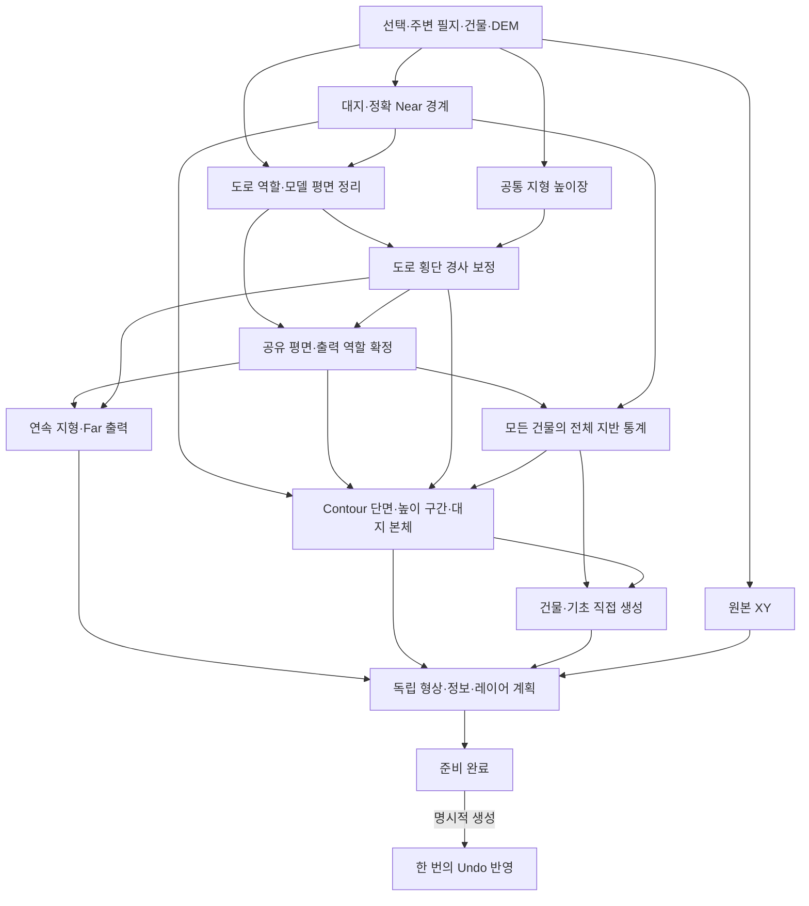

# Topo 설계

[계약](contract.md)의 전체·Contour·XY 결과를 같은 취득·좌표·정보·반영 경로로 구현한다. 형상 표현에 따라 필요한 계산만 선택하며 패널과 MCP에 업무 처리를 복제하지 않는다.

## 실행과 취득

[TopoService](../../src/topo/api/rhino/TopoService.cs)의 `TopoWorkflow`가 입력 검증·취득·백그라운드 형상 준비를 담당한다. 패널은 조회한 필지를, MCP는 PNU로 조회한 필지를 같은 준비 흐름에 전달한다. `ITopoSource`가 외부 취득 경계다. 제품은 VWorld 구현을, 서비스 검사는 고정 응답을 사용하며 형상 계산을 시험용으로 복제하지 않는다.

시작 시 UI 스레드에서 `ModelContext`에 문서 단위·허용오차·표시망 설정을 복사하고 입력과 문서 식별자를 고정한다. 표시망 설정은 문자열 스냅샷으로 보관하고 필요한 계산 구간에서만 복원·해제한다. 이후 준비 코드에는 살아 있는 `RhinoDoc`나 UI 컨트롤을 넘기지 않는다. `GeometrySlot`이 무거운 형상 계산을 프로세스당 하나로 제한하며 대기는 취소할 수 있다. 자료 취득과 준비 중에는 문서 변경 잠금을 잡지 않는다.

[PreparedModel](../../src/topo/shared/Rhino/PreparedModel.cs)은 검증된 독립 형상·표시망·속성·레이어 계획을 소유한다. 표시망이 없는 Brep 면만 복사한 문서 설정으로 미리 mesh하고, 이미 준비된 지형의 표시망은 그대로 보존한다. Rhino는 객체 등록 시 Extrusion의 사전 Render Mesh를 보존하지 않으므로 이를 중복 계산하지 않는다. Extrusion의 첫 Render Mesh는 Rhino가 생성하며 이 비용은 형상 준비·객체 반영과 구분한다. 실제 형상과 화면 표시의 검증 책임은 [형상 계약](contract.md#형상-검증과-화면-표시)을 따른다.

`RhinoModel.Prepare`와 `XYModel.Prepare`가 같은 소유권·반영 경계를 사용한다. [공통 Jobs](../../src/aha/rhino/Jobs.cs)가 문서당 작업 하나와 `running/ready/creating` 상태를 관리하며, `TopoPreparedJob`이 준비 결과를 보관·해제한다. 패널과 MCP는 이 작업을 관찰하고 생성·폐기를 요청할 뿐 준비 형상을 소유하지 않는다.

생성 요청은 `RhinoDispatch`로 UI 스레드에 전달한다. 원래 문서의 생존·단위·허용오차와 실행 중인 Rhino 명령을 확인한 뒤 생성 구간에만 `DocumentAccess` 잠금을 잡는다. 명령·변경 충돌은 준비 결과를 유지하는 재시도이고, 문서 기준 불일치나 반영 실패는 형상을 폐기하는 실패다. 생성·중복 요청·취소·종료 상태는 [공통 실행 계약](../aha/contract.md)이 소유한다.

전체 모델은 지정 출력 범위의 건물을 한 번 취득한다. [TerrainCoverage](../../src/topo/shared/Core/TerrainCoverage.cs)는 실제 생성할 건물을 공통 면적·범위 규칙으로 확정하고 **모든 생성 건물의 전체 윤곽**을 포함하는 지반 범위를 계산한다. 그 범위의 필지·DEM을 취득해 동일한 도로 분류·높이 보정을 적용한다. Near OFF도 같은 경로다. 넓어진 범위의 건물을 재조회하거나 출력 범위를 확장하지 않아 취득 대상이 연쇄적으로 늘지 않는다.

[VWorldClient](../../src/topo/api/rhino/Core/VWorldClient.cs)는 필지·건물을 `GeoFeature`로, [TerrainClient](../../src/topo/api/rhino/Core/Terrain.cs)는 DEM을 `TerrainGrid`로 정규화한다. 필지 WFS는 범위를 분할하고 요청별 `.fid` 대신 원천 식별정보·내용으로 중복과 전체 건수를 확인한다. 분할 좌표를 더 구분할 수 없는데도 응답이 불완전하면 원천 취득 실패다. 건물 Data API는 페이지를 완전 수집하며 분류 WFS는 feature ID·관리번호·층수 일치를 확인한 뒤 결합한다. 정상 수집을 누적 요청 수만으로 중단하지 않는다. 분류 응답의 좌표로 원천 윤곽을 바꾸지 않는다. DEM 누락·격자 손상은 취득 실패다. 공급원의 제약은 [데이터와 한계](../../docs/topo/data.md#현재-호출-경로)를 따른다.

XY 전용은 지정 범위의 필지·건물까지만 취득한다. [XYModel](../../src/topo/shared/Rhino/XYModel.cs)은 전체 모델과 선택 병합·좌표·`PlanarReferences`·`TopoObjectInfo`·`ModelDocumentWriter`를 공유한다. DEM이나 입체를 먼저 만들고 지우지 않는다.

## 공통 평면과 높이장

[SiteSelection](../../src/topo/shared/Core/SiteSelection.cs)이 선택 필지를 합쳐 독립 대지·면적 중심·R을 만든다. [EditRegion](../../src/topo/shared/Core/EditRegion.cs)은 원·공통접선의 정확 Near 경계를 정의한다. 지도와 평면 표본도 같은 정의에서 얻고 Rhino 출력까지 원호·접선의 유한 구간을 유지한다.

[RoadGeometry](../../src/topo/shared/Core/RoadGeometry.cs)는 도로 지목에서 비도로·미확인 필지와의 중첩을 뺀다. [ModelPlanGeometry](../../src/topo/shared/Core/ModelPlanGeometry.cs)는 100mm 폭·0.01㎡ 기준으로 모델 평면을 정리한다. 원천 경계 정리의 변경 띠는 50mm다. 그 안의 정리로 남은 독립 미세 조각은 동일 출력 구역의 이웃 역할로 재배분하고 변경 면적을 따로 집계한다. [NearRoadGeometry](../../src/topo/shared/Core/NearRoadGeometry.cs)는 Near/Far 분할 후 생긴 작은 역할 조각을 같은 구역에서 가장 긴 경계를 공유하는 반대 역할에 재배분한다. 파생 조각에 원천 변경 띠를 다시 강제하지 않고 Near 경계·XY는 보존한다.

평면 선 목록 `PathsD`는 NonZero 채움 의미를 가진다. [ContourPaths](../../src/topo/shared/Core/ContourPaths.cs)가 고정 격자로 교차를 분할하고 외곽·구멍 소유권을 확정한다. 반복 역할 재배분은 소유권이 있는 NTS 영역과 같은 정밀도의 OverlayNG로 수행하고 반환 경계에서만 선 목록으로 바꾼다. 원시 선 목록을 이미 정상인 외곽·구멍으로 해석하지 않는다.

Near 역할 정리의 정확 원호 구간과 변경 영역은 함께 보존한다. 평면 조회에는 두 영역이 공유하는 원호 표본을 사용한다. [PlanarPartition](../../src/topo/shared/Rhino/PlanarPartition.cs)은 전체 선분 교차를 확정한 뒤 양자화로 생긴 작은 연결 역할 조각을 같은 구역의 이웃에 재배분한다. 그래프 정점·피복을 유지한 채 역할만 바꾸며 변경 면적을 결과에 남긴다.

`TerrainSurface.Prepare`는 Rhino 형상을 만들기 전에 이 공유 평면과 출력 역할을 확정한다. `GroundRoadArea`는 확정된 출력 도로와 출력 밖의 취득 도로를 함께 보존하며 건물 지반 통계·Contour 계산의 공통 입력이다. `ConsumedRoadArea`는 출력 도로와 정확 역할 변경 구간을 전달한다. Contour 평면 계획이 확정되면 같은 준비 결과를 `Materialize`로 출력한다.

[TerrainField](../../src/topo/shared/Core/TerrainField.cs)는 공통 쌍선형 높이장이다. [RoadGrading](../../src/topo/shared/Core/RoadGrading.cs)은 마주 보는 도로 경계의 횡단 표본으로 DEM 노드를 보정한다. 원천 높이에서 최대 ±3m이며 별도 중심선은 사용하지 않는다. 무제약 해의 실제 잔차와 ±3m 제약 해의 투영 잔차로 수렴을 확인한다. 반복 순서는 원래 노드 순서를 유지하되 도로 영향과 두 주변 고리에 속하는 노드만 계산한다. 나머지 노드는 독립적인 0 보정값이다. 누적 잔차는 주기적으로 다시 계산하며 고정 반복 횟수의 미수렴 결과를 정상 보정으로 반환하지 않는다. 반복 중 취소를 확인한다. 모델 셀·보간·법선·교차는 1µm 평면 정밀도로 정규화한 `Model…` API를 공유한다. 원천 높이 표본 자체를 재반올림하지 않는다.

## 건물 지반과 분류

[BuildingPlacement](../../src/topo/shared/Rhino/BuildingPlacement.cs)는 모든 생성 건물의 외곽을 모델 기준으로 정리하되 원천 중정은 보존한다. 셀·도로로 분할한 전체 다각형에서 쌍선형 높이를 적분하고 경계의 이차함수 극값을 검사해 최저점·면적 가중평균을 구한다. 교차점을 다시 정밀도 격자에 반올림하지 않으며 분할 면적 합을 원래 윤곽과 대조한다. 도로는 한 번 만든 공간 인덱스에서 건물과 만날 수 있는 후보만 골라 같은 교차·적분을 수행한다. 중심점·경계점 표본만으로 지반을 대신하지 않는다.

원천 윤곽과 정리 윤곽 모두 `EditRegion.ContainsStrict`를 만족해야 Near다. 경계 접촉·교차는 Far로 유지한다. 양의 면적 겹침은 건물 제외 사유가 아니며 Near 겹침 연결 성분은 최저 기초 바닥을 공유한다. 통계와 높이 H, 각 지붕은 건물별로 유지한다.

[BuildingOverlapGroups](../../src/topo/shared/Core/BuildingOverlapGroups.cs)는 공간 색인으로 후보를 좁히고 공통 정밀도에서 양의 면적이 겹친 Near 건물을 묶는다. 한 번 확정한 묶음을 일반 기초와 Contour가 공유하며 점·변 접촉은 묶지 않는다.

[RhinoModel](../../src/topo/shared/Rhino/RhinoModel.cs)은 평균+H를 지붕, 일반 지반 최저점−1m를 기초 바닥으로 사용한다. Contour가 있으면 실제 노출판·굴착 바닥을 반영한다. Contour의 선택 대지 안은 도로 단차가 없으므로 건물 통계의 도로 평면에서도 대지 영역을 제외한다. 계단화 후 지붕 높이를 다시 계산하지 않는다.

[BuildingGeometry](../../src/topo/shared/Rhino/BuildingGeometry.cs)는 Near Extrusion과 Far의 선택 형식을 직접 만든다. 합침 모드는 기초 바닥→지붕, 분리는 바닥→평균과 평균→지붕이다. Mesh를 위해 먼저 Brep를 만들지 않으며 떨어진 외곽을 억지로 하나의 Brep로 묶지 않는다. 원천 검증만 `BuildingSourceException`으로 분리하며 내부 계산 실패를 원천 불량으로 바꾸지 않는다. 생성 대상의 식별자와 준비된 출력 식별자를 대조하고, 형상 생성 실패는 반영 전체를 중단한다.

건물의 모델 윤곽은 한 번 투영해 본체·기초·파라펫이 공유한다. [ParapetProfiles](../../src/topo/shared/Core/ParapetProfiles.cs)는 프로파일 분해 전 지붕 영역 P에서 각진 안쪽 offset을 뺀 `P − inset(P,w)`로 외곽·중정의 띠를 만든다. 분리 영역과 접촉 프로파일을 확정한 뒤 같은 Extrusion 출력으로 지붕 위에 별도 객체를 준비한다. 지붕과 inset만 각각 정규화하고 확정된 영역의 차집합을 직접 프로파일로 전달한다. Far Mesh 본체·기초는 같은 건물의 cap 삼각분할을 지연 생성해 공유하며 각 Mesh 버퍼는 독립적으로 만든다. 지형 상세 정리나 지반·Contour 재계산을 추가하지 않으며 실제 입체 검증과 준비 자원 수명은 기존 경로를 사용한다.

## 연속 지형과 대지 본체

[TerrainSurface](../../src/topo/shared/Rhino/TerrainSurface.cs)의 `Materialize`는 준비된 공유 평면에서 Mesh 또는 쌍선형 NURBS를 만든다. `Build`는 준비와 출력을 함께 호출하는 진입점이다. 넓어진 지반을 다시 표본화하지 않고 원래 셀을 절단한다. 격자·역할 선분의 원본과 유한 교점은 [PlanBoundarySources](../../src/topo/shared/Core/PlanBoundarySources.cs)에 보존한다. 격자 끝점의 허용 범위는 정수 거리 제곱으로 판정한다.

출력 영역은 원래 순서로 셀별 목록에 한 번 분류한다. 셀 삼각분할과 이후 도로 경계의 대지 투영은 이 목록을 공유하며 전체 영역을 셀마다 다시 검색하지 않는다. 정확 Near 경로의 출력 셀은 정확 분할 결과로 정하고, 대응하는 근사 영역이 없는 셀도 유지한다. Site 본체는 원래 높이장·셀 번호를 보존한 채 대지 범위를 포함하는 셀 창만 평면 분할한다. 지형을 다시 표본화하거나 전체 취득 범위를 대지마다 재분할하지 않는다.

[ExactNearRegions](../../src/topo/shared/Core/ExactNearRegions.cs)는 직선 영역과 정확 Near 원호·공통접선을 유한 교점에서 분할한다. 원본 식별자·매개변수 구간·공유 교점으로 방향 경계를 연결하고 외곽·구멍을 확정한다. 가까운 지지선이나 내부 표본으로 경계를 다시 추정하지 않는다. 같은 격자 칸의 서로 다른 교점은 합치지 않으며, 원호 끝점 밖의 지지 원 교점도 받아들이지 않는다. 격자 직선의 교점은 [PlanarRationalPoint](../../src/topo/shared/Core/PlanarRationalPoint.cs)의 유리 좌표로 공유하고 실제 비격자 교점은 이동시키지 않는다. 직선 교점의 면적도 유리 좌표에서 계산해 double 좌표로 겹쳐 보이는 미세 영역을 구분한다. 확정된 고리·영역의 면적은 한 번 계산해 재사용한다.

도로의 불변 유한 경계·winding 색인은 한 준비 작업에서 재사용한다. 패치와 판에는 범위가 만나는 원본 경계만 원래 순서로 전달하되, 영역을 둘러싼 먼 경계의 안팎 판정도 전체 색인으로 유지한다. 교점·분할 사건은 호출별로 소유하며 작업 간에 보관하지 않는다.

연속 Near/Far, Contour 판과 겹침 도로는 이 분할 결과를 공유한다. [ExactProfileGeometry](../../src/topo/shared/Rhino/ExactProfileGeometry.cs)가 소유권이 확정된 직선·원호를 Rhino 프로파일로 바꾼다. 표시용 표본은 같은 정확 경계에서 얻고 [PlanarBoundaryNoding](../../src/topo/shared/Core/PlanarBoundaryNoding.cs)으로 이웃 경계·격자를 함께 분할한다. 정확 영역의 전체 피복과 그 표본의 삼각분할 면적은 각각 검사한다. 패치 영역·분할 결과는 한 준비 안에서 재사용한다.

[TerrainSupportSurfaces](../../src/topo/shared/Rhino/TerrainSupportSurfaces.cs)는 한 번의 준비에서 도로 보정 후·내림 전 지지면을 셀 구간별로 보관한다. 연속 지형과 Site가 같은 실제 곡면을 빌려 쓰며, 빌린 면을 직접 변환하거나 해제하지 않는다. 출력 형상은 독립적으로 소유하고 지지면은 준비가 끝날 때 해제한다.

NURBS는 동일한 높이·UV인 지지면 구간만 합쳐 중복 knot를 제거한다. 실제 지형 꺾임은 유지한다. 직선 UV 경계는 격자 구간의 이차 높이 곡선으로 올리고, 곡면 위 원호는 목표 0.1mm로 근사한 뒤 실제 경계 오차 1mm를 검사한다. 표시 Mesh도 같은 면·경계를 사용한다. 높이 오차 상한에 필요한 변만 세분하며, 삼각형 대각선 교환은 영향을 받은 이웃만 다시 검사한다. 거의 같은 원 위의 점은 정확한 이진 수 판정으로 순환을 막는다. 동일 평면의 내부 정점은 줄이되 역할·격자 교점은 유지한다.

Contour 모드는 전체 평면 분할과 도로 역할을 보존하되 Far만 삼각분할·높이 정제·NURBS 출력한다. Far의 정확 분할에는 Near를 포함한 원래 역할 평면을 사용한다. 전체 평면 피복과 출력한 Far 면적·경계의 검사를 구분하며 정확 Near 경계만 의도된 구멍으로 허용한다.

Contour OFF의 Near는 연결 상면에 수직 외벽·공통 수평 바닥을 붙인다. [TerrainShellWall](../../src/topo/shared/Rhino/TerrainShellWall.cs)은 고리별 NURBS 지지면에 원본 상면 변의 분할을 유지한 trim을 만들며, [NearTerrainSolid](../../src/topo/shared/Rhino/NearTerrainSolid.cs)는 알고 있는 상면↔외벽↔바닥 변 쌍을 명시적으로 연결한다. 점 접촉은 면의 trim 순서로 고리를 구분한다. 상면 연결 시 일시적인 지지면 표식으로 원본 표시망을 전달한 뒤 표식을 제거하며, 표시 고리도 원본 면 소유권으로 대응시킨다. 공간상 가까운 면이나 경계 표본으로 소유자를 다시 추정하지 않는다. 폐합·다양체·법선·체적 검사는 실제 형상과 표시망 각각에 유지한다.

Contour의 [SiteGeometry](../../src/topo/shared/Rhino/SiteGeometry.cs)는 같은 `TerrainSurface`에 대지 평면 clip을 적용하고 도로 구분·단차 없이 곡면 상면을 만든다. `NearTerrainSolid`로 기단 윗면까지 닫는다. 대지를 계단화하거나 같은 외벽을 Contour에서 다시 만들지 않는다.

## Contour 계산과 출력

[ContourTopology](../../src/topo/shared/Core/ContourTopology.cs)는 Near 주변 쌍선형 셀의 적응 선형 근사를 공유 정점·방향 있는 변·삼각형으로 한 번 구성한다. 이웃 셀의 세분 수가 달라도 공통 변의 분할점을 통일하고 필요한 경계 삼각형만 추가 분할한다. 내부 보간점은 원래 선형 삼각형 높이를 유지한다. 높이 오차 상한은 **10mm와 간격의 1% 중 작은 값**이며 DEM 정확도나 AHA 전체 허용오차를 뜻하지 않는다.

[ContourLevels](../../src/topo/shared/Core/ContourLevels.cs)는 정수 레벨 `k×간격`을 오름차순으로 순회한다. 삼각형별 진입·종료 사건으로 활성 집합을 갱신하고 공유 변의 교점을 레벨당 한 번 계산한다. `z ≥ k×간격`의 방향 경계에서 반대 선분을 소거한 뒤 기존 1µm 격자로 한 번 노딩하고 NonZero winding으로 외곽·구멍을 확정한다. 양자화로 접촉하는 짧은 선분을 미리 삭제하지 않으며, 평탄부·동일 고도 변·안장점도 같은 포함 규칙을 따른다.

삼각형·활성 사건은 위상 할당 전에 계산한다. 각 독립 Near의 외곽 상자와 2mm 복원 여유에 걸친 셀 창만 사용하므로 떨어진 창 사이의 Far 지형은 높이 범위·위상에 포함하지 않는다. 창 안의 원단면을 먼저 곡선 외곽으로 잘라 작은 상세 판정의 경계를 바꾸지 않는다. 공유 변에 필요한 이웃 셀의 세분점은 유지하되 그 Far 셀의 삼각형·높이는 포함하지 않는다. 높이 범위는 기여 셀 기준으로 보수적으로 유지하며 정확 Near 절단은 기존 후속 계산에서 수행한다. 준비·레벨 순회·기초 수렴은 취소 토큰을 검사한다.

DEM 64타일 제한은 유지한다. 정상 계산을 삼각형·레벨·판·Mesh 면·솔버 반복량의 고정 개수만으로 중단하지 않는다. 좌표 정밀도로 구분할 수 없는 분할, 숫자·배열 표현 범위와 실제 형상 검증은 별개로 유지한다. 간격·형식·허용오차를 자동 변경하지 않는다.

`ContourPlan`은 `ContourLevels`의 높이 범위·근사 오차와 오름차순 `At(k)` 단면을 사용하며, 도로 내림·Site 제외·기초·판 정리는 후속 평면 계산으로 수행한다.

[ContourPlan](../../src/topo/shared/Core/ContourPlan.cs)은 원단면과 도로·대지 분할을 불변 입력으로 보존한다. [ContourRegions](../../src/topo/shared/Core/ContourRegions.cs)는 NonZero 정규화를 진입 시 한 번 수행하고 외곽·구멍·범위를 가진 영역을 재사용한다. 기존 1µm 격자의 OverlayNG를 사용하며, 중간 영역은 그 영역을 사용하는 경계와 함께 수명을 끝낸다. 전역 캐시는 없다.

100mm 폭 판정을 위한 offset은 생략 후보를 찾는 계산이다. 실제 판은 원래 단면·도로·대지·기초 경계와 확인된 생략 영역으로 구성한다. 대지를 제외한 땅·도로에서 대지 경계에 새로 생긴 작은 상세를 먼저 판정한다. 이후 등고 단면이나 굴착이 새로 자른 경계에 접한 상세만 판정하며, 이미 정리된 정상 경계를 다시 축소·확대하지 않는다. 생략 영역은 offset 중간 정밀도에서 직접 구한 뒤 기존 모델 격자에서 한 번 확정한다. 반올림된 정리 결과를 원본에서 다시 빼서 생략을 재구성하지 않는다. 중정·기초 구멍은 보호하고, 정확 Near 분할 뒤 생긴 작은 독립 판도 같은 정책으로 처리한다.

[ContourOmissions](../../src/topo/shared/Core/ContourOmissions.cs)는 역할별 생략을 높이순으로 누적한다. 도로 내림·기초 하강으로 최초 원단면보다 낮은 상세판이 생겨도 초기 역할 생략을 이어받는다. 지지판·기단은 별도 피복 규칙을 따른다. 공간 색인으로 현재 판과 만나는 영역만 조회하고 실제 만나는 생략끼리만 합친다. 현재 판 밖의 생략도 위 판에 필요할 수 있어 유지한다. 판은 정확 외곽·구멍과 높이 구간을 소유하며, `Profiles`·`SourceProfiles`는 표본·평면 판정용이다. 판 수 집계·Extrusion 출력·실제 지반 조회의 원본은 같은 정확 영역이다.

노출 영역은 서로 이웃한 레벨의 차집합이다. 도로 단차는 노출 상면에만 적용한다. 단차가 간격 이상이면 완전한 상부 판을 건너뛰고 남은 두께만 출력한다. 아래 판 전체를 이동하지 않는다. 선택 대지와 닿지 않는 Near 건물만 노출판의 최저 바닥까지 굴착하고 그 바닥 위 판에서 전체 건물 윤곽을 뺀다. 판을 만든 뒤 3D BooleanDifference를 실행하지 않는다.

`Exposures`는 최초 굴착 깊이를 정하는 굴착 전 노출판이다. [ContourExposureCache](../../src/topo/shared/Core/ContourExposureCache.cs)는 판의 하단·상단 사건으로 활성 후보를 구하고, 정확 영역의 범위 상자가 만나는 판만 노출면의 재사용 의존 대상으로 삼는다. 접촉도 후보에 포함하며 의존 집합은 입력 순서와 무관하다. 차집합으로 실제 덮인 영역을 빼서 `GroundExposures`를 구한다. 이는 굴착·작은 상세 생략 후 실제 출력 판의 정확 영역이다. 범위 상자·표본은 후보 검색에만 쓰고, 양의 면적 교차와 접촉은 원본 유한 구간·공유 교점으로 구분한다. 건물 묶음의 지반은 각 건물 윤곽으로 조회하며 조회용 합집합을 새 지반 경계로 해석하지 않는다.

비굴착 묶음은 실제 지반−1m, 굴착을 포함한 겹침 묶음은 이미 파인 바닥 이하의 등고 레벨을 공유한다. 기초가 내려가면 활성 구멍이 바뀐 판부터 갱신하고, 생략 변화는 같은 역할의 위 판에 전파한다. 입력·활성 구멍·누적 생략 상태가 같아지는 단계는 재사용한다. 노출면은 변경 판과 그 판이 덮는 상면만 다시 계산하고 해당 영역과 만나는 건물 묶음만 재조회한다. 비굴착 바닥 변화는 판 재생성을 요구하지 않는다. 변화가 없을 때 수렴하며 임의 회차 제한이나 자기 굴착 바닥의 추가 1m 하강은 없다.

단면·활성 구멍 합집합·판·노출면은 한 준비 안에서만 재사용한다. 다음 회차에도 쓰는 결과만 유지하며 이전 회차의 대체된 자료를 계속 축적하지 않는다. 겹침 도로와 `MinimumGroundElevation`도 같은 확정 상면을 사용하고 굴착을 다시 적용하지 않는다.

겹침 도로는 `GroundExposures`와 도로를 정확 Near 영역 안에서 분할하고 작은 역할 조각을 같은 노출판 안에서 재배분한다. 도로만 남은 독립 미세 표시 조각은 생략하되 아래 땅판은 유지한다. 원본 XY·대지·기초 구멍은 바꾸지 않고 변경 평면을 `OverlayRoleChanges`에 남긴다. 표본을 격자로 옮길 때 생기는 교차는 삼각분할 전에 정규화하며, 이를 잘못된 구멍으로 해석하지 않는다.

최저 상세 L 아래에 두 지지판과 두꺼운 기단을 추가한다. 상세판·지지판은 대지 영역을 제외하고 기단은 전체 Near를 받친다. 깊이·높이 표현과 실제 단면·입체를 객체 반영 전에 검사한다.

[ContourGeometry](../../src/topo/shared/Rhino/ContourGeometry.cs)는 확정된 정확 단면에서 내부 구멍을 가진 Extrusion을 직접 생성한다. [정확 프로파일 출력](../../src/topo/shared/Rhino/ExactProfileGeometry.cs)은 직선 연결부는 1차 NURBS, 일반 원호는 ArcCurve로 표현한다. native 원호로 표현할 수 없는 짧은 구간은 인접 구간과 함께 정확한 유리 2차 NURBS로 묶는다. 극히 짧은 교점 간격도 좌표 삭제 없이 보존한다. Rhino 면적 적분값이 검증 범위를 벗어나고 적분 오차 추정도 검증 범위를 넘으면 명시적인 적분 정확도로 재측정하며 기하 허용오차는 바꾸지 않는다. [ProfileContact](../../src/topo/shared/Core/ProfileContact.cs)는 실제 공유 정점의 방향 경계로 재료 부채꼴과 빈 각도 구간을 구해 접촉 단면을 같은 위치의 단순 프로파일로 나눈다. 건물과 등고판이 이 분해를 공유하며 임의 방향의 반복 절단은 하지 않는다. 양의 두께·유효성·폐합·체적을 검사하며 Brep로 몰래 바꾸지 않는다. 겹침 도로는 실제 남은 판 위의 평면이며 이미 확정된 외곽·구멍을 공통 XY=UV trim으로 직접 만든다. 표시망은 삼각분할의 정점 ID를 그대로 공유하며 출력 후 좌표 병합으로 연결을 다시 만들지 않는다.

Near 외벽은 [TerrainBoundaryGeometry](../../src/topo/shared/Rhino/TerrainBoundaryGeometry.cs)에서 정확 원호·접선을 격자 셀 경계에서 나누어 연속 높이장에 직접 올리고 기단 윗면까지 수직으로 내린다. 직선의 쌍선형 높이는 이차 곡선, 원호와 쌍선형 높이의 합성은 유리 4차 곡선으로 표현하며 임시 지형 면이나 3D Boolean을 만들지 않는다. 기존 경계 오차 기준을 유지한다. [ContourBoundary](../../src/topo/shared/Core/ContourBoundary.cs)는 Far 도로의 역할이 바뀌는 곳에서 외벽을 분리하며 일치하는 접선은 재료 방향으로 소유를 정한다. 이 판정에는 Contour 계산 범위로 다시 자르기 전의 확정 도로(`FarRoads`)를 사용해 Far와 같은 전환점을 유지한다. 열린 NURBS 외벽은 등고판의 옆면과 겹칠 수 있고 판 수 집계에서 제외한다. 노출판별 경계 절단이나 높이차 부호 탐색은 필요하지 않다.

## 참조선·정보·반영

[PlanarReferences](../../src/topo/shared/Rhino/PlanarReferences.cs)는 원본 XY를 모델 정리·입체 성공 여부와 독립적으로 준비한다. 선택 대지경계는 보존하고 주변 원천 선만 범위에서 자른다. Contour OFF에서만 대지경계를 보정 지형에 투영한다. Contour ON에서는 `Site` 본체에 대지 정보를 붙이고 XY는 참조로 유지한다.

[TopoObjectInfo](../../src/topo/shared/Rhino/TopoObjectInfo.cs)는 [Info 계약](../info/contract.md)의 객체 JSON을 만든다. 생성한 건물의 본체·기초·XY는 같은 JSON을 재사용하고 실제 바닥·평균·지붕은 기술 태그로 구분한다. 원천 응답에서 없는 주소를 별도 조회하지 않으며 병합된 땅·도로에 원필지 원장을 만들지 않는다.

[TopoPanel](../../src/topo/api/rhino/TopoPanel.cs)은 지도 조회·필지 선택·설정 입력을 담당하고 지도 HTML은 입력·표시만 맡는다. KEY revision 변경 시 이전 타일·캐시를 폐기하고 지도 세대·패널 수명으로 지연 응답을 거른다. 연산을 시작하기 전에 편집 중인 숫자 값을 확정한다. [ModelRangeInput](../../src/topo/api/rhino/ModelRangeInput.cs)은 직접 입력과 방향 Stepper를 구분하며 잘못된 편집값을 이전 값으로 대체하지 않는다. 범위·옵션·지형 요청량은 같은 연산 가능 판정에 참여한다. 입력 실패 이유는 작업 요약·종료 사유와 분리해 표시하므로 지도 복원이 결과를 덮어쓰지 않는다. 공통 작업의 상태 변경을 UI 스레드로 전달하고, 패널 재표시 시 현재 작업을 조회한다. 진행·준비 중에는 고정 입력 요약을 표시하며 생성 버튼은 KEY와 별개로 `ready`에서만 활성화한다. 패널 수명에 연결한 취소는 지도·검색 요청에만 적용한다.

지도 WebView는 내장 HTML만 표시한다. 기본 브라우저 메뉴를 끄고 준비된 페이지의 탐색·Reload를 취소해 선택과 화면을 유지한다. KEY 변경에 따른 호스트 재로드는 먼저 지도 상태를 초기화해 허용한다. 모든 메시지는 HTML 페이지 식별자를 가지며 이전 페이지와 초기화 전의 선택·타일 요청은 상태 변경 전에 거절한다. 타일 응답은 페이지 식별자와 별도의 화면 요청 순번으로 판정한다. 필지 선택·드래그는 주 버튼만 처리한다. 작업 잠금 중에도 현재 페이지의 `ready`는 수락하되 선택 변경과 타일 요청은 보류한다. 잠금 해제·재표시는 기존 resize 지연 경로로 현재 화면의 타일과 선택을 갱신하며 중심·확대 수준을 초기화하지 않는다. 같은 종료 상태를 다시 받아도 현재 입력 오류를 유지하고 입력 수정 시 안내와 연산 가능 상태를 함께 갱신한다. 실제 WebView 동작은 [지도 수명 검사](../../src/topo/checks/service/MapNavigationChecks.cs)가 확인한다.

[ModelDocumentWriter](../../src/topo/shared/Rhino/ModelDocumentWriter.cs)는 준비된 형상을 한 번의 Undo로 반영한다. 지원 형식·유효성은 준비 시 확인하고 생성 시 다시 계산하지 않는다. 건물·기초·파라펫은 예상 체적과 기존 허용범위를 내부 준비 객체로 전달한다. Extrusion은 검증용 Brep를 한 번 만들어 실제 edge 폐합·다양체·양의 체적과 예상 체적 보존을 함께 확인한 뒤 해제하며 출력 형식은 유지한다. 추가 실패가 나면 이번 객체·레이어를 제거한 뒤 실제 복구 여부를 검사한다. 반영 진입 후 중간 취소하지 않으며 반영된 결과를 취소 상태로 바꾸지 않는다. 생성·실패·폐기 후 준비 형상의 native 자원을 해제한다.

검증 경로는 [Topo 검사 안내](../../src/topo/checks/README.md)에 있다. 일반 계산·지도·취득 검사와 실제 Rhino 형상·설치본 서비스 검사를 구분한다.
